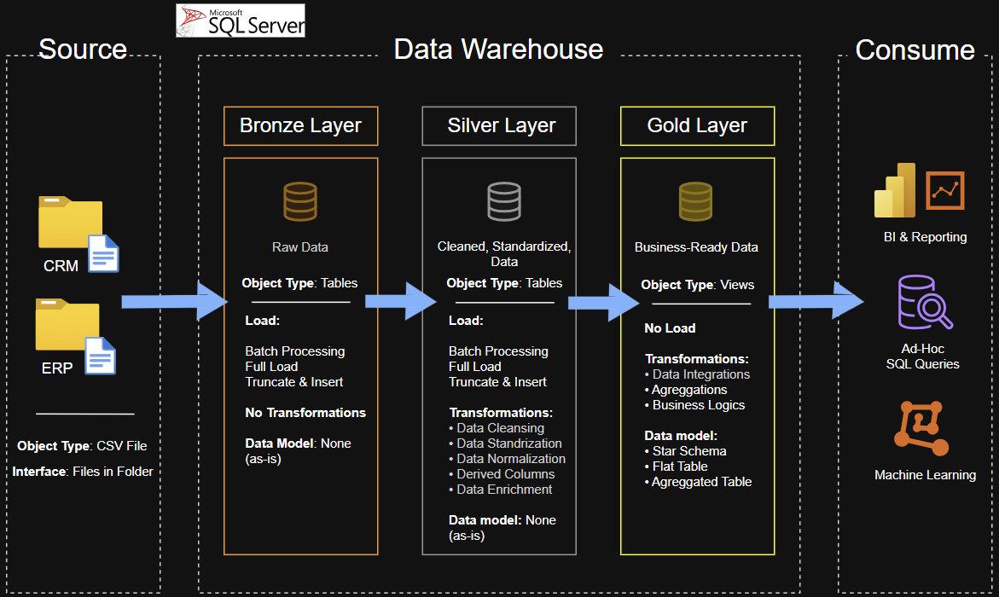
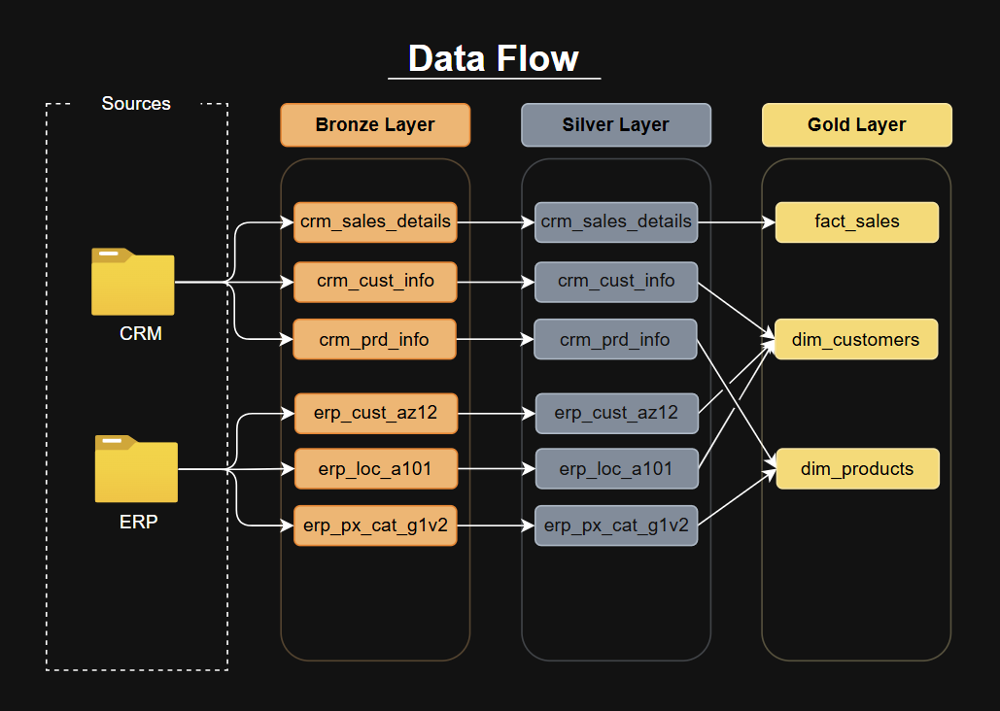
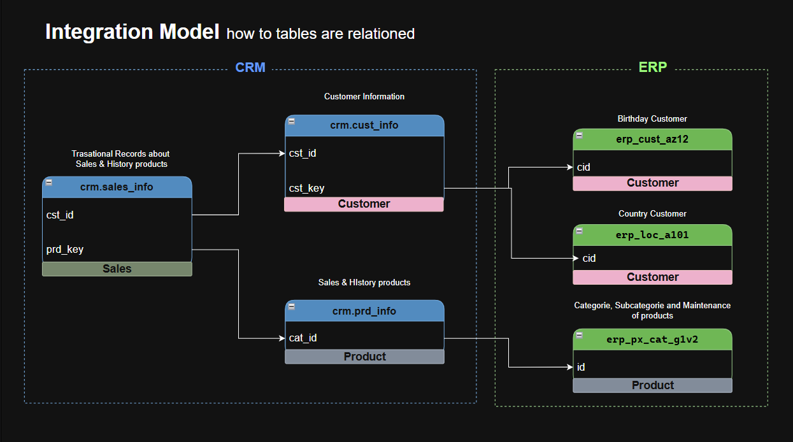
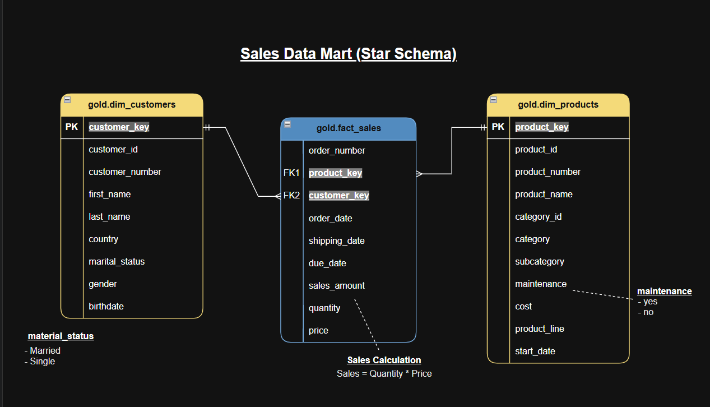

# Data Warehouse Project: Medallion Architecture with SQL Server
**Foundation for analytics: from raw CRM/ERP data to a star schema ready for BI.**

An end-to-end data warehouse built with **SQL Server**, consolidating CRM and ERP sales data into a star schema ready for analytics. The focus of this project is **data architecture and data modeling**: how raw data becomes reliable, business-ready data.

> 🇧🇷 Built by a Brazilian student, entirely in English (code, comments and documentation) as a deliberate way to practice technical English alongside data analytics.

---

## 🏗️ Data Architecture

The project follows the **Medallion Architecture** with three layers:



| Layer | Purpose | Details |
|-------|---------|---------|
| 🥉 **Bronze** | Raw data, as-is | CSV files ingested into SQL Server via `BULK INSERT` |
| 🥈 **Silver** | Cleaned and standardized | Deduplication, trimming, type casting, normalization of values, handling of invalid dates |
| 🥇 **Gold** | Business-ready | Star schema (fact and dimension views) with surrogate keys |

---

## 🎯 What I Practiced

- **Data modeling:** designing a star schema (fact and dimensions), surrogate keys and integration between two source systems
- **Layered architecture:** separating raw, cleansed and business-ready data, with a clear responsibility for each layer
- **Data cleansing:** removing duplicates, unwanted spaces, null handling, standardizing categorical values and fixing invalid dates
- **Data integration:** combining CRM and ERP sources, using one as the primary source and the other as a fallback
- **Data quality validation:** writing quality-check scripts for each layer to verify results (see `tests/`)
- **Documentation:** data catalog, naming conventions, architecture, flow and model diagrams
- **Technical English:** the entire project is written in English

---

## 🔄 Data Flow and Model

**Data Flow**


**Data Integration**


**Gold Layer Model (Star Schema)**


---

## 🧪 Data Quality

Each layer is validated by SQL scripts that return **no rows when everything is correct**:

- `tests/quality_checks_silver.sql`: null or duplicate primary keys, unwanted spaces, standardization, invalid date ranges, cross-field consistency
- `tests/quality_checks_gold.sql`: surrogate key uniqueness and referential integrity between fact and dimensions

---

## 🛠️ Tech Stack

- **SQL Server Express** and **T-SQL** (stored procedures, views, window functions)
- **SSMS** for development and execution
- **Draw.io** for architecture, flow and model diagrams
- **Git / GitHub** for version control

---

## 📂 Repository Structure

```
sql-data-warehouse-project/
│
├── data/                       # Source datasets
│   ├── source_crm/             # CRM files (customers, products, sales)
│   └── source_erp/             # ERP files (customer details, locations, product categories)
│
├── docs/                       # Documentation and diagrams
│   ├── data_catalog.md         # Gold layer data catalog
│   ├── naming_conventions.md   # Naming standards
│   ├── requirements.md         # Project requirements
│   └── *.png                   # Architecture, flow, integration and model diagrams
│
├── scripts/
│   ├── init.sql                # Database and schemas creation
│   ├── bronze/                 # DDL and load procedure (raw layer)
│   ├── silver/                 # DDL and load procedure (cleansing and transformation)
│   └── gold/                   # Star schema views
│
├── tests/                      # Data quality checks (silver and gold)
│
└── README.md
```

---

## ▶️ How to Run

1. Install **SQL Server Express** and **SSMS**
2. Run `scripts/init.sql` to create the database and the `bronze`, `silver` and `gold` schemas
3. Run `scripts/bronze/ddl_bronze.sql`, then `scripts/bronze/proc_load_bronze.sql`
4. Run `scripts/silver/ddl_silver.sql`, then `scripts/silver/proc_load_silver.sql`
5. Run `scripts/gold/ddl_gold.sql`
6. Execute the load procedures (`EXEC bronze.load_bronze` and `EXEC silver.load_silver`) and validate with the scripts in `tests/`

> ⚠️ Update the CSV file paths in `proc_load_bronze.sql` to match your local machine.

---

## 📚 Documentation

- [Requirements](docs/requirements.md)
- [Data Catalog](docs/data_catalog.md)
- [Naming Conventions](docs/naming_conventions.md)

---

## 🚀 Next Steps

The scope of this project is the **end-to-end architecture and modeling** of the data warehouse. The natural next step is to consume the Gold layer in a BI tool (Power BI) to analyze customer behavior, product performance and sales trends.

---

## 👤 About Me

**Nicholas Belo**, Software Engineering student at **FIAP** (São Paulo, Brazil), building a career in **Data Analytics**.

I built this project to understand how raw data becomes trustworthy data: modeling, cleaning and validating it before analysis. Knowing what happens behind the dashboard helps me ask better questions and trust the numbers I deliver.

**Currently looking for:** Data Analyst opportunities (junior/intern).
**Stack:** SQL (T-SQL), data modeling, data quality, Power BI (next step)

- 💼 LinkedIn: https://www.linkedin.com/in/nicholasbelo/
- 🐙 GitHub: https://github.com/nickbelo2201

---

## 🙏 Acknowledgments

This project was developed as a learning exercise, following the methodology of the SQL Data Warehouse course by [Data With Baraa](https://www.youtube.com/@DataWithBaraa).
